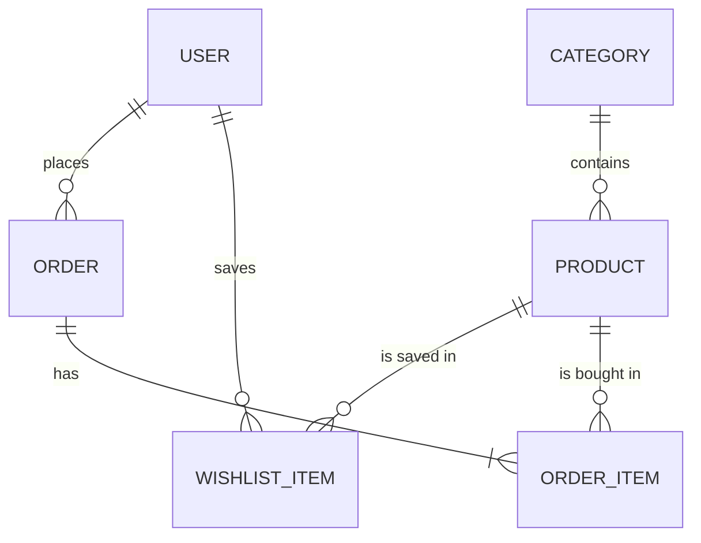

# Database

PostgreSQL, accessed with Prisma. The schema is in `server/prisma/schema.prisma`.

## Diagram

## Decisions

- Money is stored in cents as integers (1999 means $19.99), to avoid rounding bugs.
- IDs are UUIDs, so order and product IDs cannot be guessed in sequence. Ownership is still checked on every query.
- Products that were ordered are never deleted, they are deactivated with `isActive = false`.
- `OrderItem` keeps a copy of the product name and price at purchase time, so old orders do not change when a product changes.
- Deleting a user, a product or a category that is used by orders or products is refused (`Restrict`). Wishlist items are removed together with their user or product (`Cascade`).
- CHECK constraints in the first migration stop negative prices, negative stock, negative totals and zero quantities, even if the application code has a bug.
- Better Auth tables (session, account, verification) will be added later .

## Commands (run inside `server/`)

| Command                   | What it does                                                                  |
| ------------------------- | ----------------------------------------------------------------------------- |
| `npm run db:generate`     | Generate the typed Prisma client                                              |
| `npm run db:migrate`      | Create and apply a migration in development                                   |
| `npm run db:deploy`       | Apply existing migrations (production and CI)                                 |
| `npm run db:seed`         | Fill the development database with categories and products                    |
| `npm run db:studio`       | Browse the data in the browser                                                |
| `npm run db:reset`        | Delete everything and rebuild from the migrations, then run `npm run db:seed` |
| `npm run db:test:migrate` | Apply migrations to the test database                                         |

The test database is created once with `npm run db:test:create` (run it in the project root). The generated client is not committed, so after cloning the project run `npm run db:generate`.
