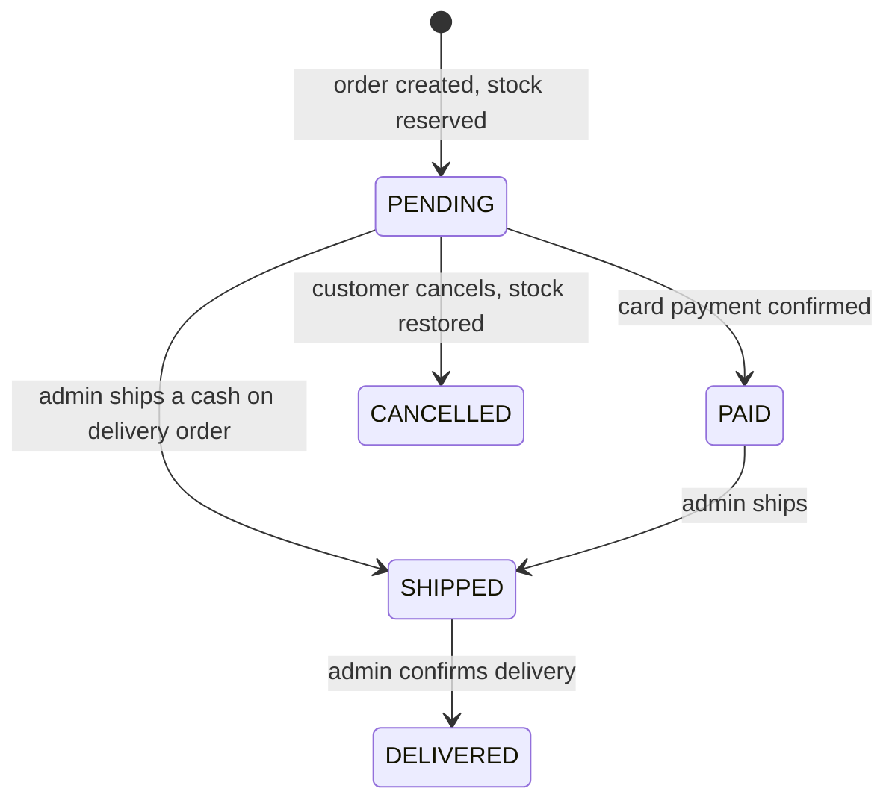

# Orders

## Status flow

A customer can only cancel a `PENDING` order.

## Rules

- The server is the truth. The client sends product ids and quantities only. Prices and names come from the database when the order is created, and are copied into the order items (a snapshot).
- Creating an order is one transaction: read the products, reserve the stock, create the order. If any step fails, nothing is saved.
- Stock is reserved with one atomic update (`stock >= quantity`), so two orders cannot take the same last item. A CHECK constraint in the database (`stock >= 0`) is the last safety net.
- Products are always handled in the same order (sorted by id), so two orders cannot block each other in a deadlock.
- Cancelling is also a transaction. An atomic update moves the order from `PENDING` to `CANCELLED`, and only the request that wins it restores the stock. Cancelling twice never restores the stock twice.
- An order of another user is "not found" (404), never "forbidden" (403), so the API does not confirm that it exists.
- Customers never receive `userId` or `stripeSessionId`.

## Known limits

- The price is read at the start of the transaction. If an admin changes it at that very moment, the order uses the price read a moment earlier. This is acceptable for this project.
- Shipping cost and taxes are not calculated, delivery is free in this demo.
