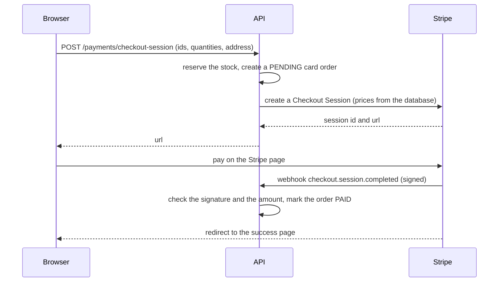

# Payments

Card payments use Stripe Checkout in test mode only. Cash on delivery needs no payment provider.

## Flow

If the customer never pays, the session expires after about 30 minutes. Stripe sends `checkout.session.expired`, and the API cancels the order and restores the stock.

## Security rules

- The server builds the Stripe session from the order items (prices of the database). The client never sends prices.
- The webhook route reads the raw body and checks the `Stripe-Signature` header with the webhook secret. Without a valid signature nothing is processed.
- The order is found with the session id saved by the server, and the amount and currency must match the order.
- Events can arrive twice. Updates only apply to an order that is `PENDING` and `UNPAID`, so repeating an event changes nothing.
- The success page is only a message. Only the webhook changes an order to `PAID`.
- The secret key and the webhook secret live in environment variables, and the `Stripe-Signature` header is hidden in the logs.
- If Stripe cannot be reached, the order is cancelled and the stock restored.
- When a customer cancels a card order, the Stripe session is expired so nobody can pay for it.

## Local development with the Stripe CLI

1. Create a Stripe account and copy the test secret key (`sk_test_...`) in `server/.env`.
2. Install the CLI and log in: `brew install stripe/stripe-cli/stripe`, then `stripe login`.
3. Forward events to the API: `stripe listen --forward-to localhost:4000/api/payments/webhook`.
4. Copy the `whsec_...` secret printed by the command in `server/.env` as `STRIPE_WEBHOOK_SECRET`.
5. Pay with the test card `4242 4242 4242 4242`, any future date and any CVC. The card `4000 0000 0000 9995` is declined.
6. Expire a session with `stripe checkout sessions expire cs_test_...`.

For the deployed app, create a webhook endpoint in the Stripe dashboard that points to `/api/payments/webhook` and use its own secret.

## Known limits

- If a payment completes at the very moment the customer cancels the order, the order is already cancelled. The webhook logs an error ("refund needed") and a refund must be made by hand in the Stripe dashboard.
- If saving the session id fails after Stripe created the session, the order is cancelled but the Stripe page stays open until it expires.
- Only cards are accepted, in USD. Refunds are not built.
